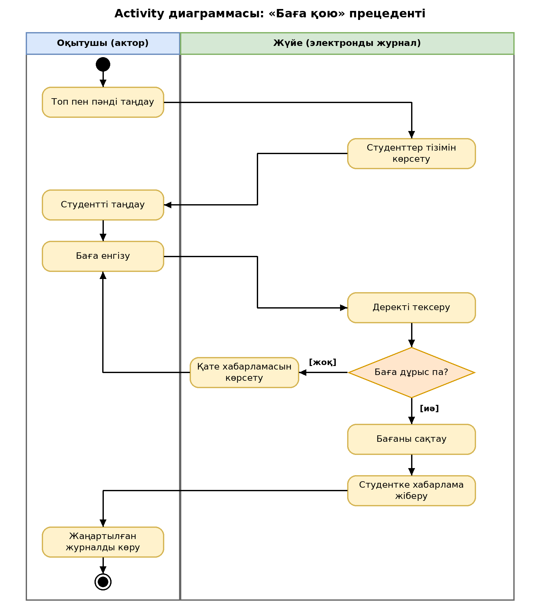
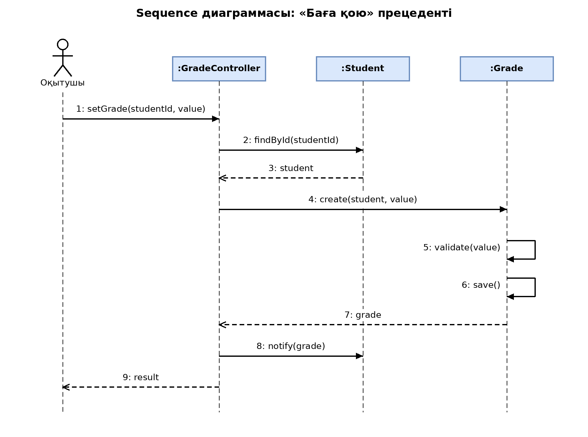

# Колледждің электронды журналы

Автор: [султанмуратов данияр], [ВтКи-к-24-]

## Мәселе
Колледжде бағалар жиі қағаз журналда немесе бөлек файлдарда сақталады: оларды іздеу, түзету және студентке жеткізу қиын.
Жүйе оқытушыға бағаны тез енгізуге, студентке өз бағаларын дереу көруге, ал әкімшілікке жалпы үлгерімді бақылауға мүмкіндік береді.

## Акторлар
- Оқытушы
- Студент
- Әкімшілік (деканат)

## Талаптар
### Функционалдық
1. Жүйе оқытушыға таңдалған топ пен пән бойынша студентке баға қоюға мүмкіндік беруі керек.
2. Жүйе енгізілген бағаның дұрыстығын тексеруі керек.
3. Жүйе студентке жаңа баға туралы хабарлама жіберуі керек.

### Функционалдық емес
1. Баға енгізу операциясы 2 секундтан аспауы керек.
2. Деректерге рұқсат рөлдер бойынша бөлінуі керек.

## Диаграммалар
### 1. Use Case
_(кейін қосылады)_

### 2. Class
_(кейін қосылады)_

### 3. Activity: Баға қою

### 4. Sequence: Баға қою

